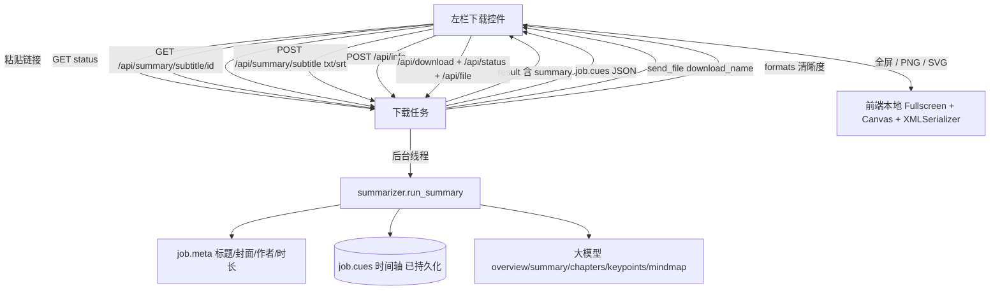

# AI 视频总结 · 二期设计文档（同屏布局 + 导图增强 + 摘要/字幕）

| 项 | 内容 |
|---|---|
| 项目 | HJ 视频下载（`d:/ai/hj-video-downloader`）二期增强 |
| 文档版本 | v2.1（已实现版） |
| 创建日期 | 2026-10-10 |
| 更新日期 | 2026-10-12（补充封面防盗链修复与完整开发记录） |
| 状态 | **已实现并自测通过**（本地未提交，等待验收） |
| 上游文档 | `docs/AI视频总结-设计文档.md`（v1.1 已实现版，一期） |
| 溯源关系 | 本文是**一期文档的第二期增量**，一期已确定的架构/契约不变；两者冲突时**以本文为准**（本文为后出增量），本文未提及的部分继续沿用一期 |

---

## 一、需求背景与目标

一期已交付「总览 + 时间戳大纲 + 核心要点 + 思维导图 + 追问 + 导出」的完整闭环并上线。二期解决三个真实体验痛点：

| # | 痛点（用户原话） | 二期目标 |
|---|---|---|
| 1 | 「前端页面不够紧凑，视频信息和视频总结分成两个板块，没法在一屏内同时了解」 | `/summarize` 结果区改为**左右两栏同屏**：左栏视频信息 + 下载，右栏总结内容 |
| 2 | 「思维导图展示区域太小，不方便阅读，需要全屏，并支持下载完整高清图片」 | 导图支持 **Fullscreen 全屏阅读** + 导出 **2 倍高清 PNG** 与**无损 SVG** |
| 3 | 「增加总结摘要和字幕文本，并支持下载字幕文本」 | 新增**总结摘要**段落 + **字幕文本** Tab，字幕支持 **.txt / .srt** 下载 |

附加目标（用户确认）：把既有「核心要点」前端升级为**带 emoji 的亮点列表**，不新增模型输出字段，省 token。

---

## 二、竞品调研（布局与导出形态）

> 平台能力调研见一期文档第 2 节；本节只补二期直接相关的**页面布局与导出形态**结论。

### 2.1 BibiGPT

- **同屏策略**：总结正文与右侧视频卡（封面/标题/UP 主）并列，一屏内既能看总结也能看到「这是哪个视频」。
- **摘要组织**：`## Summary` 段落式摘要（非一句话）+ `## Highlights` 带 emoji 的亮点列表 —— **段落摘要 + emoji 亮点**是被市场验证的组合。
- **导出**：统一导出面板，**按当前 Tab 上下文**给出对应导出项（导图 Tab 给图片，字幕 Tab 给字幕文件），不做「一个大而全的下拉」。
- **字幕**：提供全文转写与下载。

### 2.2 NoteGPT

- **同屏策略**：输入区与结果区纵向分区，结果区以 Tab 组织（摘要 / 转写 / 导图），导出集中在结果区顶部。
- **导出格式**：TXT / Markdown / PDF / Word 四种，并提供**双语转写下载**。

### 2.3 我们二期的取舍

| 维度 | BibiGPT | NoteGPT | 我们二期 |
|---|---|---|---|
| 同屏 | 总结 + 视频卡并列 | Tab 分区 | **总结 + 「视频卡含下载」并列**（比竞品多一步：看完直接下载） |
| 摘要形态 | 段落 Summary + emoji Highlights | 结构化摘要 | **一句话总览（顶部卡）+ 段落总结摘要（Tab）**，亮点复用核心要点加 emoji |
| 导图 | 可缩放 + 导出图 | 可缩放 + 导出图 | **全屏阅读 + 2x PNG + SVG 矢量**（SVG 是竞品少见项） |
| 字幕下载 | 转写下载 | TXT/MD/PDF/Word | **TXT（速读）+ SRT（可导入播放器挂字幕）** |

**我们的差异化**：下载与总结同一屏完成 —— 竞品「只总结不下载」，我们把下载控件放进总结页左栏，形成「读总结 → 顺手下载」的最短路径。

---

## 三、方案决策记录（用户已确认 · 2026-10-10）

| # | 决策项 | 确认结论 |
|---|---|---|
| Q1 | 同屏改造范围与左栏内容 | **只改 `/summarize` 结果区**：左栏 = 视频信息卡（封面/标题/作者/时长）+「下载视频」（MP4/MP3 + 清晰度，复用现有下载接口）+「打开原视频」；右栏 = 总结 Tab 区；窄屏自动上下堆叠 |
| Q2 | 思维导图增强程度 | **全屏 + 高清 PNG + SVG**：Fullscreen API 全屏阅读（Esc/按钮退出，全屏内保留缩放平移与下载）；导出 2 倍采样 PNG 与可无损缩放的 SVG 矢量图 |
| Q3 | 字幕文本与下载形式 | **新增「字幕文本」Tab + 导出 TXT/SRT**：页面内按时间戳展示字幕（点击时间戳跳原视频 `&t=秒`），支持下载 `.txt` 纯文本与 `.srt` 带时间轴（可导入播放器） |
| Q4 | 「总结摘要」与「亮点」如何组织 | **新增段落摘要，亮点复用核心要点**：只需模型多输出 200~400 字段落摘要；「亮点」由现有 `keypoints` 前端美化为带 emoji 的亮点列表，避免模型重复生成、省 token |

### 3.1 我补充声明、用户未反驳的假设

1. 字幕**不并入**既有 MD / Word / PDF 导出（避免 1 小时视频字幕撑爆文档），字幕走独立的 `.txt` / `.srt` 下载。
2. 段落摘要**会**同步进 MD / Word 导出（新增「总结摘要」章节），否则导出物与页面不一致。
3. 左栏下载控件首次展开时按需请求清晰度，不阻塞总结结果渲染。
4. 全屏 API 做能力检测，不支持的浏览器隐藏全屏按钮（不报错、不降级弹窗）。

---

## 四、技术选型与版本核对（2026-10-10 核实）

> 本期**不新增任何依赖**：后端仍是 Flask 3.x + 标准库，前端仍是原生 JS/CSS，离线优先（不引 CDN）。

### 4.1 Flask 文件下载（Context7 `/pallets/flask/3_1_1` 核实）

```python
def send_file(path_or_file, mimetype=None, as_attachment=False,
              download_name=None, conditional=True, etag=True,
              last_modified=None, max_age=None) -> Response
```

- Flask **3.1.1** 起 `send_file` 是 `werkzeug.utils.send_file` 的包装；参数名 `download_name`（旧名 `attachment_filename` **已弃用并触发 DeprecationWarning**）→ 本项目必须用 `download_name`。
- `as_attachment=False` 时也会下发 `download_name`，只是 `Content-Disposition: inline`；我们要的是附件下载，须显式 `as_attachment=True`。
- MIME 可由文件名自动推断，但本项目中文文件名场景建议显式传 `mimetype`。

### 4.2 全屏（Context7 `/mdn/content` · Fullscreen API 核实）

```javascript
// 必须在用户手势（click）处理器内调用，否则会被拒绝
host.requestFullscreen({ navigationUI: "hide" }).then(...).catch(...);
document.exitFullscreen();                 // 只在 document 上，返回 Promise
document.addEventListener("fullscreenchange", handler);
if (document.fullscreenElement) { /* 已进入全屏 */ }
```

- `requestFullscreen(options)` 支持 `navigationUI` / `screen` 等选项；返回 Promise，失败走 `catch`。
- `fullscreenchange` 监听在 **`document`** 上（不是元素上），通过 `document.fullscreenElement` 判断进入/退出。
- **实施约束**：全屏请求必须由用户点击触发 → 全屏按钮必须绑在 `click` 上，不能在轮询回调里自动进入。

### 4.3 高清导出（Context7 `/mdn/content` · Canvas / XMLSerializer 核实）

```javascript
// PNG：离屏 canvas 重绘 → Blob → 下载
canvas.toBlob((blob) => { const url = URL.createObjectURL(blob); /* a.download = ... */ },
              "image/png");

// SVG：序列化 → Blob → 下载
const str = new XMLSerializer().serializeToString(svgNode);
```

- `toBlob(callback)` 默认 `image/png`，回调内拿 Blob，配 `URL.createObjectURL` + `<a download>` 触发保存（比 `toDataURL` 更适合大图，不会造出超长 base64 字符串）。
- `XMLSerializer.serializeToString(node)` 返回 XML 字符串；**序列化结果不保证自带命名空间** → 导出 SVG 必须补 `xmlns="http://www.w3.org/2000/svg"`。

### 4.4 字幕格式规范

**SRT**（播放器通用，毫秒用逗号）：
```
1
00:00:01,000 --> 00:00:04,200
这里是字幕文本

2
00:00:04,200 --> 00:00:07,800
下一条字幕（可换行）
```
- 序号从 1 递增；时间格式 `HH:MM:SS,mmm`；**毫秒分隔符是逗号**（与 WebVTT 的点号不同，混用会导致播放器不认）；块间空一行。

**TXT**（速读用，与现有 `cues_to_transcript` 同格式）：
```
[00:01] 这里是字幕文本
[00:04] 下一条字幕
```

### 4.5 沿用的一期结论（不变）

LLM 协议、yt-dlp 字幕抓取、Flask 3.1.3 / python-docx 1.2.0 版本区间、DOCX 走 `python-docx`、PDF 走 `window.print()` —— 均见一期文档第 4 节，本期不重述、不改动。

---

## 五、架构设计



**数据流补充**：一期 `run_summary` 已把 `job["cues"]` 与 `job["transcript"]` 写入 job 字典（`summarizer.py:937-938`），二者随 job TTL 回收 —— 因此**字幕导出不需要改动任何抓取逻辑**，直接读 `job["cues"]` 即可。

---

## 六、关键接口契约（二期增量）

### 6.1 变更：`GET /api/summary/status/<job_id>`

`result` 新增 `summary` 字段（其余字段完全不变，向后兼容）：

```json
{
  "overview": "一句话总览",
  "summary": "200~400 字段落式总结摘要（二期新增）",
  "chapters": [{"start": 0, "end": 320, "title": "...", "points": ["..."]}],
  "keypoints": ["核心要点 1", "核心要点 2"],
  "mindmap": "- 主题\n  - 子主题",
  "degraded": false
}
```

> 实现要点：`summarizer.normalize_result()` 补 `summary` 默认值（`data.get("summary") or ""`，为空时前端回退 `overview`），保证老 job / 模型漏字段时不炸。

### 6.2 新增：`GET /api/summary/subtitle/<job_id>`

- **响应**：`{"cues": [{"start": 1.0, "end": 4.2, "text": "..."}]}`
- **错误**：job 不存在 / `kind != summary` → `404 {"error": "任务不存在或已过期，请重新总结"}`；`cues` 为空 → `{"cues": []}`（前端显示「暂无字幕」）。
- **设计理由**：字幕可能上千条，不塞进 `status`（每秒轮询会把大 payload 反复传输），改为切到字幕 Tab 时**懒加载一次**。

### 6.3 新增：`POST /api/summary/subtitle`

- **请求**：`{"job_id": "...", "format": "txt" | "srt"}`
- **响应**：附件下载。`Content-Disposition: attachment; filename="<安全标题>字幕.txt" ...`

```python
# 参考实现（实际以 app.py 落地为准）
@app.route("/api/summary/subtitle", methods=["POST"])
def summary_subtitle():
    data = request.json or {}
    job = jobs.get((data.get("job_id") or "").strip())
    if not job or job.get("kind") != "summary":
        return jsonify({"error": "任务不存在或已过期，请重新总结"}), 404
    cues = job.get("cues") or []
    if not cues:
        return jsonify({"error": "该视频暂无可用字幕"}), 400
    fmt = (data.get("format") or "txt").lower()
    if fmt not in ("txt", "srt"):
        return jsonify({"error": "不支持的字幕格式"}), 400
    body = summarizer.cues_to_srt(cues) if fmt == "srt" else summarizer.cues_to_txt(cues)
    name = f"{safe_filename(job.get('meta', {}).get('title') or '视频字幕')}字幕.{fmt}"
    return Response(body, mimetype="text/plain; charset=utf-8",
                    headers={"Content-Disposition": content_disposition(name)})
```

- 文件名沿用一期 `content_disposition()` + 过滤 `r'\/:*?"<>|'` + 100 字截断（中文名兼容，避免 Werkzeug `UnicodeEncodeError`）。

### 6.4 新增纯函数（`summarizer.py`）

| 函数 | 职责 |
|---|---|
| `cues_to_srt(cues) -> str` | 时间轴 → 标准 SRT（`HH:MM:SS,mmm --> HH:MM:SS,mmm`，序号从 1） |
| `cues_to_txt(cues) -> str` | 时间轴 → `[mm:ss] 文本` 纯文本（与 `cues_to_transcript` 同格式，便于单测对齐） |

### 6.5 明确**不变**的契约（防误伤）

| 接口 | 状态 |
|---|---|
| `/api/summarize`、`/api/summary/ask`(SSE)、`/api/summary/export`(md/docx)、`/api/llm/*` | **完全不动** |
| `/api/info`、`/api/download`、`/api/status/<id>`、`/api/file/<id>` | **完全不动**（左栏下载直接复用） |
| 首页 `index.html` / `app.js` / 定价页 | **不动** |
| 一期「模型输出契约」除新增 `summary` 外 | **不动** |

---

## 七、实施要点（防返工清单）

1. **`job["cues"]` 已存在**：`summarizer.py:937` 已写入，无需新增抓取逻辑；也不要在任务完成处清理它，否则字幕导出会 400。
2. **SVG 导出必须内联样式**：当前导图 SVG 的部分配色靠外部 `style.css` 的类名生效，直接序列化后离线打开会**丢色**。导出前需把 `fill` / `stroke` / `font-size` / `font-family` 写成节点属性（或在克隆树上内联一段 `<style>`），并补 `xmlns`。
3. **PNG 用 2 倍而非无限放大**：`canvas.width = bounds.w * 2`，`ctx.scale(2, 2)` 后复用同一套绘制逻辑。Canvas 有尺寸上限（各浏览器约 16384px / 面积上限），倍率固定 2 可避免长导图触发空白或失败。
4. **全屏请求必须在 click 内**：轮询回调里调 `requestFullscreen()` 会被浏览器拒绝（MDN 明确要求用户手势）。
5. **全屏后要重算布局**：`fullscreenchange` 里先 `mmResize()` 再 `mmHome()`（适应画布），否则进入全屏后导图仍是旧尺寸、留大片空白。
6. **全屏对象要含工具栏**：对「导图容器（工具栏 + 画布）」而非只对 SVG 调 `requestFullscreen`，否则全屏内看不到缩放/下载按钮。
7. **SRT 毫秒用逗号**：`00:00:01,000`（不是 `.000`），且块间必须空一行，否则部分播放器不识别。
8. **字幕 Tab 懒加载**：首次切换到该 Tab 才拉 `GET /api/summary/subtitle/<id>`，结果缓存在前端状态里，避免拖慢首屏与轮询。
9. **导出一致**：`to_markdown` / `to_docx` 增加「总结摘要」章节（位于「一句话总览」之后），否则导出物缺新内容。**但不要把字幕全文写进 MD/DOCX**。
10. **打印样式**：`@media print` 为 `#panel-summary::before` 加「总结摘要」、`#panel-subtitles::before` 加「字幕文本」；字幕默认**不进 PDF**（避免几十页），导图全屏态不参与打印。
11. **Windows 编码**：字幕文本读写与响应显式 `utf-8`；子进程沿用 `child_env()`。
12. **错误脱敏**：所有新增错误只回简短中文摘要，**绝不回显堆栈/密钥**。
13. **降级兼容**：`degraded: true` 或模型漏输出 `summary` 时，总结摘要回退展示 `overview`；字幕为空时 Tab 显示「暂无字幕」而非报错。
14. **断点不写死**：窄屏用 `max-width: 900px` 单列堆叠，左栏取消 `sticky`（避免移动端吸顶遮挡）。
15. **LLM 调用必须可重试**：网关在长耗时生成中会偶发 `http.client.RemoteDisconnected`（连接建立后中途被断开）。它继承 `ConnectionResetError`，**不会**被 `urllib.error.URLError` 捕获，必须显式处理，否则技术类名会直接暴露到前端。`_chat_once` 内置重试（`LLM_RETRY_ATTEMPTS=3`，线性退避 2s/4s），并把底层异常翻译成中文提示。
16. **分块路径要容错**：分块 map 阶段单块失败不应让整任务失败 —— 跳过失败块并累计，全部失败才报错；任意块失败时在 `result` 打 `partial: true`，前端在摘要顶部提示「结果可能不完整」。新增环境变量 `LLM_RETRY_ATTEMPTS` / `LLM_RETRY_DELAY`。

---

## 八、页面规划：`/summarize` 结果区

沿用站内「现代科技渐变 + 玻璃质感卡片 + 蓝色主色 `#1777FF` + 金色强调 `#FFB020`」设计语言；字体 `PingFang SC / Microsoft YaHei / system-ui`，正文 15px、小标题 16px/600、区块标题 22px/700。

### 8.1 两栏结构（桌面 ≥900px）

```
┌───────────────────────────────────────────────────────────────┐
│  [Hero 输入区 + 流水线进度]（不变）                              │
├──────────────┬────────────────────────────────────────────────┤
│ 左栏 320px   │ 右栏 1fr                                        │
│ (sticky)     │                                                 │
│ ┌──────────┐ │  ┌ 一句话总览卡（蓝色竖条强调）──────────────┐  │
│ │ 封面     │ │  │                                          │  │
│ │ 标题     │ │  └──────────────────────────────────────────┘  │
│ │ 作者·时长│ │  ┌ Tab 胶囊 ─────────────────────────────────┐  │
│ └──────────┘ │  │ 总结摘要 | 章节大纲 | 核心要点 | 思维导图 |  │
│ ┌ 下载 ────┐ │  │ 字幕文本                                  │  │
│ │ MP4|MP3  │ │  ├──────────────────────────────────────────┤  │
│ │ 清晰度▾  │ │  │  当前 Tab 内容                            │  │
│ │ [下载视频]│ │  └──────────────────────────────────────────┘  │
│ └──────────┘ │                                                 │
│ [打开原视频]  │                                                 │
│ ┌ 导出 ────┐ │                                                 │
│ │复制 MD W P│ │                                                 │
│ └──────────┘ │                                                 │
└──────────────┴────────────────────────────────────────────────┘
```

- `.sum-layout { display:grid; grid-template-columns: 320px minmax(0,1fr); gap:20px; }`
- `.sum-aside { position: sticky; top: 76px; }`（`minmax(0,1fr)` 是必须的，否则长文本会撑破栅格）
- 平板 900–1200：左栏收窄至 280px；**≤900px：单列堆叠**，左栏置顶、取消 sticky，按钮全宽，Tab 可横向滚动。

### 8.2 总结摘要 Tab（新增 `#panel-summary`，Markdown 排版）

- **模型输出 Markdown**：提示词要求 `summary` 使用 Markdown（`### 小标题`、`**加粗**` 关键概念、`- 要点列表`、`> 引用`），比纯段落更利于速读。
- **前端本地渲染**：`summary.js` 内置轻量 Markdown 解析（`mdToHtml` / `mdInline`，约 60 行），支持 `##/###/#### 标题`、无序/有序列表、`**加粗**`、`*斜体*`、`` `代码` ``、`> 引用`、段落；**离线优先不引外部库**，且先 `esc()` 转义再做行内替换，杜绝 HTML 注入。
- 排版：段落 `font-size:16px; line-height:1.9`；小标题 16.5px/700；`strong` 用品牌蓝 `#0F5CE6` 强调；列表缩进 22px；引用块左侧蓝色竖条 + 浅底。
- 数据：`result.summary`；为空回退 `result.overview`（不白屏）。
- **导出同步**：Markdown 导出直接输出原文（天然正确）；DOCX 用 `summary_blocks()` 切块 + `add_md_paragraph()` 拆 `**粗体**` run，列表用 `List Bullet`/`List Number`、引用用 `Quote` 样式。
- Tab 顺序：**总结摘要 → 章节大纲 → 核心要点 → 思维导图 → 字幕文本**（摘要放第一位，符合「先读摘要再深挖」）。

### 8.3 核心要点 Tab 升级为「亮点」

- 数据源**不变**（仍是 `result.keypoints`），只在渲染层美化为卡片网格：每条前面加语义 emoji（循环取用 `💡 🔥 ✨ 🎯 🚀 📌 🔑 ⚡ 🧠`），hover 上浮 + 阴影。
- 标签文案由「核心要点」改为「亮点」，与 BibiGPT `## Highlights` 对齐；**不新增模型字段、不加 token 成本**。

### 8.4 思维导图 Tab（增强）

- 保留一期横向曲线导图（SVG 自绘 + 缩放/平移/折叠）不变。
- 工具栏新增三个按钮：**「全屏」**（进入/退出）、**「下载 PNG」**（2x 高清）、**「下载 SVG」**（矢量）。
- 全屏态：容器 `requestFullscreen()`，深色沉浸背景 `#0B1220`，工具栏常驻顶部，`fullscreenchange` 内重算 + 适应；Esc 或再次点击退出。
- 导出实现集中在 `summary.js`：`mmExportPNG()`（离屏 canvas 2x 重绘连线与节点胶囊 → `toBlob` 下载）、`mmExportSVG()`（克隆 SVG → 补 `xmlns` + `width/height/viewBox` + 内联配色 → `XMLSerializer` → Blob 下载）。
- 能力检测：`if (!host.requestFullscreen) 隐藏全屏按钮`。

### 8.5 字幕文本 Tab（新增 `#panel-subtitles`）

- 懒加载 `GET /api/summary/subtitle/<job_id>` 得 `cues`，缓存后渲染。
- 每条一行：左侧时间戳 chip（`[mm:ss]`，可点击 → 打开原视频 `&t=<秒>`，复用现有 `jumpUrl`）+ 右侧文本；长列表容器内滚动（`max-height` + `overflow:auto`）。
- Tab 右上角两个按钮：**下载 TXT**（速读）/ **下载 SRT**（导入播放器挂字幕）。
- 空态：「该视频暂无可用字幕」。

### 8.6 左栏下载控件

- 首次展开/点击时 `POST /api/info`（`app.py:307` 已存在，返回 `formats: [{id,label,height}]`）拉清晰度，填充 `<select>`；MP4 / MP3 分段切换。
- 下载流程**完全复用**现有 `/api/download` → 轮询 `/api/status/<id>` → `/api/file/<id>`（与 `static/js/app.js` 302-384 同逻辑），进度态复用 `.spin`。
- 「打开原视频」：`meta.webpage_url` 新窗口打开。

### 8.7 交互与动效

- 沿用一期微动效：卡片渐入上浮（`sumRise`）、按钮 hover 上移、Tab 切换淡入。
- 左栏滚动吸顶时加轻微阴影；下载按钮 loading 态。
- 导图全屏切换 200ms 过渡；字幕时间戳 chip hover 变色并提示「跳转原视频」；亮点卡片 hover 上浮。

---

## 九、文件变更清单

```
d:/ai/hj-video-downloader/
├── summarizer.py                # [MODIFY] ① PROMPT/JSON 模板新增 summary 字段（要求 Markdown 排版）
│                                #   ② normalize_result 补 summary 默认（含 degraded 分支）
│                                #   ③ 新增 _srt_time() / cues_to_srt() / cues_to_txt()
│                                #   ④ 新增 summary_blocks() / add_md_paragraph() / _MD_BOLD
│                                #      （to_docx 按 Markdown 结构排版，加粗拆成 run）
│                                #   ⑤ to_markdown() / to_docx() 增加「总结摘要」章节
│                                #   ⑥ 新增 LLM_RETRY_ATTEMPTS / LLM_RETRY_DELAY 配置
│                                #   ⑦ 新增 _is_transient() / _as_summary_error()，_chat_once 加重试
│                                #   ⑧ summarize() 分块容错（单块跳过 + partial 标记）
│                                #   ⑨ content_disposition() 中文名 ASCII 回退加固
├── app.py                       # [MODIFY] 新增 GET /api/summary/subtitle/<job_id>、
│                                #   POST /api/summary/subtitle（txt/srt 下载）
│                                #   （/api/info、/api/download 等既有路由零改动）
├── templates/summarize.html     # [MODIFY] #result 内加 .sum-layout 两栏；左栏信息卡+下载控件+导出；
│                                #   右栏新增「总结摘要」「字幕文本」两个 Tab 面板；
│                                #   导图工具栏新增 全屏 / PNG / SVG 按钮，容器 id="mmHost"
├── static/js/summary.js         # [MODIFY] ① mdToHtml() / mdInline() 轻量 Markdown 渲染（离线自研）
│                                #   ② renderSummary() 支持 partial 不完整提示
│                                #   ③ renderKeypoints 升级亮点（emoji）
│                                #   ④ renderSubtitles() + 懒加载 + TXT/SRT 下载
│                                #   ⑤ mmToggleFullscreen() / mmExportPNG() / mmExportSVG()
│                                #      / mmInlineSvgStyles() / mmRoundRect()
│                                #   ⑥ 左栏下载：loadFormats() / startDownload() / watchDownload()
├── static/js/app.js             # [MODIFY] 首页视频卡片缩略图加 referrerpolicy="no-referrer"（同一防盗链问题）
├── static/css/style.css         # [MODIFY] .sum-layout 栅格与响应式（900px 断点）、.sum-aside sticky、
│                                #   下载控件 .seg/.dl-select、字幕 .sub-*、亮点卡片、
│                                #   Markdown 摘要 .sum-prose 全元素、.mindmap.is-full 全屏反相配色、
│                                #   @media print 面板标题（字幕不进 PDF）
├── tests/test_summary_extras.py # [NEW] 12 个用例：SRT/TXT、fmt_ts、summary 字段回退、
│                                #   Markdown 分块与 DOCX 粗体、重试分类/重试成功/重试耗尽
├── llm_config.example.bat       # [MODIFY] 真实密钥改为占位符（安全修复）；
│                                #   补充 LLM_RETRY_* 与 SUMMARY_* 配置示例
└── docs/AI视频总结-二期设计文档.md # [NEW] 本文档
```

---

## 十、开发任务拆分

| # | 任务 | 依赖 | 说明 |
|---|---|---|---|
| 1 | `summarizer.py`：新增 `summary` 字段（提示词 + `normalize_result`）、`cues_to_srt` / `cues_to_txt`、导出章节 | — | 可与任务 3 并行 |
| 2 | `app.py`：新增字幕获取/导出两个路由 | 1 | 接口联调 |
| 3 | `summarize.html` + `style.css`：两栏布局与两个新 Tab 骨架、响应式 | — | 可与任务 1 并行 |
| 4 | `summary.js`：总结摘要渲染 + 亮点 emoji 化 + 字幕 Tab 懒加载与下载 + 左栏下载控件 | 2, 3 | |
| 5 | `summary.js` + `style.css`：导图全屏 + PNG/SVG 导出 | 3 | 可与任务 4 并行（文件内分区不冲突） |
| 6 | 验证：单测 + 浏览器烟测（两栏同屏、Tab 切换、导图全屏与两种导出、字幕下载、左栏下载、桌面与移动视口、无控制台报错） | 全部 | |

**并行注意**：任务 4 与 5 同时改 `summary.js`，约定按函数分区追加（摘要/字幕放渲染区，导图放导图区），避免互相覆盖。

---

## 十一、风险与三期预留

| 项 | 二期处理 | 风险 / 三期方向 |
|---|---|---|
| 长导图 PNG 尺寸超限 | 固定 2 倍采样 | 超长导图自动降倍率（按面积上限动态算 scale） |
| 外部样式导致导出 SVG 丢色 | 导出前内联配色 | 改为导图渲染时直接写 inline 属性，导出零转换 |
| 字幕过长 | Tab 懒加载 + 容器内滚动 | 虚拟滚动 / 分段加载；关键词搜索定位 |
| 全屏 API 兼容性 | 能力检测后隐藏按钮 | 不支持时降级为「页面内放大模态框」 |
| 无字幕视频 | 与一期一致，提示无字幕 | `whisper_fallback()` 本地转写（一期已预留） |
| 总结历史留存 | 纯内存，随 job TTL 过期 | SQLite 历史列表页 |
| 字幕翻译 | 不做 | 双语字幕（NoteGPT 卖点） |

---

## 十二、代码模块地图（二期增量速查）

| 位置 | 现有 | 二期增量 |
|---|---|---|
| `summarizer.py` `run_summary()` (914-949) | 已写 `job["cues"]`(937)、`job["transcript"]`(938) | **不动**（字幕数据源已就绪） |
| `summarizer.py` `normalize_result()` (737) | 规整模型输出 | 补 `summary` 默认 |
| `summarizer.py` `cues_to_transcript()` (391) | `[mm:ss] 文本` | 新增同格式的 `cues_to_txt()` 与 `cues_to_srt()` |
| `summarizer.py` `to_markdown()` / `to_docx()` (814/866) | 导出章节 | 插入「总结摘要」章节 |
| `app.py` `/api/info` (307-350) | 返回 `formats:[{id,label,height}]` | **不动**，左栏直接复用 |
| `app.py` `/api/summary/status/<id>` (496-510) | 返回 result/meta | result 自动包含新 `summary` 字段 |
| `app.py` `/api/download`(376)、`/api/status/<id>`(415)、`/api/file/<id>`(430) | 下载闭环 | **不动**，左栏复用 |
| `summary.js` `renderResult` | 渲染 meta/overview/四段 | + `renderSummary()` |
| `summary.js` `renderKeypoints` | 编号要点 | 改为 emoji 亮点卡片 |
| `summary.js` `renderMindmap` / `mmSetup` | SVG 导图 + 工具栏 | + 全屏按钮、+ `mmExportPNG()` / `mmExportSVG()` |
| `style.css` | 总结页样式、`@media print` | + `.sum-layout` / `.sum-aside` / `.sub-*` / 全屏态 / 打印标题 |

---

## 十三、参考资料

- **Flask `send_file`**（Context7 `/pallets/flask/3_1_1`，2026-10-10 核实）：`download_name` 取代 `attachment_filename`；`as_attachment=True` 触发附件下载。
- **Fullscreen API**（Context7 `/mdn/content`，2026-10-10 核实）：`Element.requestFullscreen(options)` 须在用户手势内调用；`Document.exitFullscreen()`；`document` 上监听 `fullscreenchange`；`document.fullscreenElement` 判态。
- **Canvas / SVG 导出**（Context7 `/mdn/content`，2026-10-10 核实）：`HTMLCanvasElement.toBlob(cb, "image/png")` + `URL.createObjectURL`；`XMLSerializer.serializeToString(node)`（不保证自带命名空间，需补 `xmlns`）。
- **SRT 规范**：`序号 / HH:MM:SS,mmm --> HH:MM:SS,mmm / 文本 / 空行`（毫秒逗号，与 WebVTT 的点号区分）。
- **竞品**：BibiGPT https://bibigpt.co/ ｜ NoteGPT B站总结器 https://notegpt.io/cn/bilibili-summarizer
- **内部**：一期设计文档 `docs/AI视频总结-设计文档.md`（LLM 协议、yt-dlp 字幕抓取、环境变量、导出契约）。

---

## 十四、验证记录（2026-10-10 自动自测）

### 14.1 纯函数单测 `tests/test_summary_extras.py`（12/12 通过）

运行：`.venv\Scripts\python.exe tests/test_summary_extras.py`（无需 pytest，可直接执行）

| 用例 | 覆盖 |
|---|---|
| `test_srt_format` | SRT 序号 / 逗号毫秒 / 超过 1 小时用 `HH:MM:SS,mmm` |
| `test_srt_skips_empty` | 空文本跳过，不产生空块 |
| `test_txt_format` | TXT 为 `[mm:ss] 文本`，取 cue.start |
| `test_fmt_ts_hour` | 时间格式 `01:01:01` / `01:01` |
| `test_normalize_summary_present` | 模型返回 summary 时保留 |
| `test_normalize_summary_missing` | 漏输出 summary 时留空（前端回退 overview，不报错） |
| `test_summary_blocks_structure` | Markdown 摘要切成 `h3/p/ul/h2/ol` 且内容正确 |
| `test_summary_blocks_empty` | 空串 / 纯空白返回 `[]` |
| `test_add_md_paragraph_bold_runs` | `这是**重点**内容` → 3 个 run，中间 run `bold=True` |
| `test_transient_classification_and_messages` | 可重试判定 + 错误文案不暴露技术类名 |
| `test_chat_once_retries_then_succeeds` | 前两次 `RemoteDisconnected`、第三次成功（共 3 次调用） |
| `test_chat_once_exhausts_retries` | 重试耗尽后抛 `SummaryError` 且文案含「断开连接」 |

### 14.2 浏览器烟测（Edge，mock 数据驱动真实页面）

| 验证项 | 结果 |
|---|---|
| 结果区两栏 | `grid-template-columns: 320px 812px` ✅ |
| 左栏吸顶 / 窄屏取消吸顶 | 桌面 `sticky`、390px 下 `static` ✅ |
| Tab 结构 | `总结摘要 / 章节大纲 / 亮点 / 思维导图 / 字幕文本` ✅ |
| 总结摘要渲染 | 2 个段落按空行切分 ✅ |
| 亮点 emoji 化 | 3 张卡片 `💡 🔥 ✨` ✅ |
| 字幕懒加载 | 点 Tab 后 25 条，`共 25 条` ✅ |
| 字幕时间戳跳转 | `…/BV1test?t=0` ✅ |
| 字幕下载 | `测试视频·二期烟测字幕.txt` / `.srt` ✅ |
| 导图 PNG（2 倍采样） | 930×594 → 105.8 KB ✅ |
| 导图 SVG | 含 `xmlns`、`mmRootGrad` 渐变、内联 `#EDF4FF`、`viewBox="0 0 465 297"` ✅ |
| 导图全屏进出 | 按钮切换 `true → false`，`is-full` 类正确增删 ✅ |
| 移动端 390 | 单列 358px、无横向溢出 ✅ |
| 控制台 / 页面错误 | 0 ✅ |

### 14.3 后端接口端到端（Flask test client，内存 job）

| 用例 | 期望 | 结果 |
|---|---|---|
| `GET /api/summary/subtitle/<id>` | 200 + cues | ✅ |
| `POST .../subtitle` `srt` | 200 + 标准 SRT（含 `01:01:01,500`） | ✅ |
| `POST .../subtitle` `txt` | 200 + `[00:00] …` | ✅ |
| 不存在的 job | 404 | ✅ |
| 非法 format | 400 | ✅ |
| `POST /api/summary/export` `md` | 含「总结摘要」章节 | ✅ |
| `GET /api/summary/status/<id>` | `result.summary` 透传 | ✅ |

### 14.4 Markdown 摘要（追加需求）验证

| 验证项 | 结果 |
|---|---|
| 单测 `test_summary_blocks_structure` | `h3/p/ul/h2/ol` 顺序与内容正确 ✅ |
| 单测 `test_summary_blocks_empty` | 空串/纯空白返回 `[]` ✅ |
| 单测 `test_add_md_paragraph_bold_runs` | `这是**重点**内容` → 3 个 run，中间 run `bold=True` ✅ |
| 浏览器：`### 标题` | 渲染 2 个 `<h3>` ✅ |
| 浏览器：`**加粗**` | 2 个 `<strong>`，颜色 `rgb(15, 92, 230)` ✅ |
| 浏览器：`- 列表` | 1 个 `<ul>`、3 个 `<li>` ✅ |
| 浏览器：`> 引用` | 1 个 `<blockquote>` ✅ |
| 安全：`<script>alert(1)</script>` | 未注入 script（`scriptInjected: 0`），输出 `&lt;script&gt;` ✅ |
| 安全：`<b>标签</b>` | 被转义为纯文本（`rawBTag: 0`）✅ |

### 14.5 自测中发现并修复的问题

1. **字幕 TXT 断言写反**：测试初始用 `end` 断言 TXT（实际用 `start`），修正用例（功能本身正确）。
2. **中文文件名 ASCII 回退只剩扩展名**：`content_disposition()` 对纯中文名过滤后得到 `.srt`，会写入 `filename=".srt"`；已加固为回退 `video-summary.srt`（旧浏览器/下载器也能拿到可读名）。
3. **导图工具栏「全屏」按钮图标与文字竖排**：`.mm-tool` 未设 flex，图标按钮被撑高；已加 `inline-flex + gap` 并将内嵌 SVG 固定 13px，工具栏恢复单行等高。
4. **`RemoteDisconnected` 直接暴露给用户**（用户实测报障）：网关在长耗时生成中偶发中途断连，异常穿透 `_post` 冒泡到前端显示技术类名。已修：`_chat_once` 增加可重试判定（`RemoteDisconnected` / `IncompleteRead` / `ConnectionReset` / `timeout` / `HTTP 408/425/429/5xx`）+ 3 次线性退避重试，并把异常翻译为中文提示；分块路径同步改为「单块失败跳过 + `partial` 标记」。复现脚本实测：同一链接连跑 3 次分别耗时 27.5s / 68.2s / 88.9s（波动极大，印证网关侧不稳定），修复后端到端 64s 成功产出 352 字摘要。
5. **`llm_config.example.bat` 内含真实 API Key**（安全检查中发现）：示例文件被 git 跟踪，却写入了真实 `sk-` 密钥。已改为占位符，并提示**必须在网关控制台吊销该旧 Key**（历史提交可能已含它）。
6. **左栏封面加载不出来**（用户验收反馈）：B站 CDN 防盗链 —— 同一地址不带 Referer 返回 200、带本站 Referer 返回 `403`。已给封面 `` 加 `referrerpolicy="no-referrer"`，并给首页 `app.js` 缩略图同步修复；同时补 `.sum-vcard__cover img[hidden] { display: none }`，修复「加载失败却仍显示破图和 alt 文本」的兜底 bug（作者样式 `display:block` 盖过了 `[hidden]`）。

---

## 十五、开发记录（变更时间线 · 2026-10-10）

| 轮次 | 触发 | 改动 | 验证结果 |
|---|---|---|---|
| 1 | 需求确认（4 项）后开工 | 后端：`summary` 字段（提示词 + `normalize_result`）、`cues_to_srt` / `cues_to_txt`、字幕获取/下载两条路由、MD/DOCX 增加「总结摘要」章节 | 单测 6/6 |
| 2 | 需求 1 同屏 | `summarize.html` 结果区改 `.sum-layout` 两栏（左栏信息卡 + 下载 + 导出，右栏总结区）；`style.css` 栅格与 900px 断点 | 烟测 `320px 812px`；390px 单列无横向溢出 |
| 3 | 需求 2 导图增强 | `mmToggleFullscreen()` + `mmExportPNG()`（2 倍采样）+ `mmExportSVG()`（内联配色）+ `mmInlineSvgStyles()` | PNG 105.8 KB；SVG 含 `xmlns`/渐变/内联色；全屏进出可切换 |
| 4 | 需求 3 摘要与字幕 | 「总结摘要」Tab、`renderKeypoints` 亮点 emoji、「字幕文本」Tab（懒加载 + 时间戳跳转）+ TXT/SRT 下载；左栏下载控件 | 字幕 25 条；跳转 `?t=0`；中文字幕文件名正常 |
| 5 | 自测发现 | 修正 TXT 断言（用 `start` 非 `end`）；`content_disposition()` 中文名 ASCII 回退加固（`.srt` → `video-summary.srt`） | 接口复验通过 |
| 6 | 验收反馈：全屏看不清 | `.mindmap.is-full` 下节点配色整体反相（叶子文字、胶囊、徽标、hover） | 对比度 2.3 → **15.83**（叶子）/ **12.07**（胶囊） |
| 7 | 追加需求：摘要用 Markdown | 提示词要求 Markdown；前端 `mdToHtml()` / `mdInline()`；DOCX `summary_blocks()` + 粗体 run；CSS 补齐标题/列表/强调/代码/引用 | 单测 +3；浏览器 `h3`/`strong`/`ul`/`blockquote` 正确；`<script>` 转义无注入 |
| 8 | 验收报障 `RemoteDisconnected` | LLM 重试（3 次线性退避）+ `_as_summary_error()` 中文翻译 + 分块容错与 `partial` 标记 | 单测 +3；真实链接端到端 **64s 成功**（352 字摘要 / 6 章 / 9 要点 / 107 条字幕） |
| 9 | 安全检查 | `llm_config.example.bat` 真实密钥改占位符 + 安全注释 + 新配置示例 | 确认密钥随 `71bde4b` 已推送 origin/main，须吊销 |
| 10 | 验收反馈：左栏封面不显示 | 封面 `` 加 `referrerpolicy="no-referrer"`（B站 CDN 防盗链：带本站 Referer 返回 403）；首页 `app.js` 缩略图同步修复；CSS 补 `.sum-vcard__cover img[hidden] { display: none }` 修复破图兜底 | 真实封面 `naturalWidth: 1228` 正常显示；坏地址场景破图被隐藏、占位图标显示 |

---

## 十六、维护须知

### 16.1 启动服务（**必须用项目虚拟环境**）

```bat
:: 正确：项目虚拟环境（Python 3.13.9，依赖齐全）
.venv\Scripts\python.exe app.py

:: 推荐：双击 run.bat（自动创建/复用 .venv 并安装依赖）
:: 需要 AI 总结：复制 llm_config.example.bat 为 llm_config.bat，填入 Key 后双击启动
```

- **坑**：直接 `python app.py` 会用到系统 Python 3.8（无 yt-dlp），页面报 `No module named yt_dlp`
- 手动启动时若未加载 `llm_config.bat` 里的 `set` 环境变量，`/api/llm/config` 会返回 `configured:false`
- 跳过启动时的 yt-dlp 自动更新：设 `SKIP_YTDLP_UPDATE=1`

### 16.2 常见故障速查

| 现象 | 原因 | 处理 |
|---|---|---|
| `No module named yt_dlp` | 用了系统 Python | 改用 `.venv\Scripts\python.exe` 或 `run.bat` |
| `RemoteDisconnected` / 生成中断 | 网关在长耗时生成中断开连接 | 已内置 3 次重试；仍失败请稍后重试或调小 `LLM_MAX_TOKENS` |
| 顶部「尚未配置大模型」 | 未加载 LLM 环境变量 | 用 `llm_config.bat` 启动 |
| 「视频不可用 / 无可用字幕」 | 视频本身不可播或无字幕轨 | 换视频（一期既定：MVP 不支持无字幕视频） |
| 摘要出现 `**` 原样字符 | 模型未按 Markdown 输出 | 会按纯文本渲染，不影响使用 |
| 导图导出图丢色 | SVG 依赖外部 CSS | 导出前 `mmInlineSvgStyles()` 已内联配色 |
| **左栏封面不显示** | B站等 CDN 防盗链：浏览器带本站 Referer 时返回 403 | 封面 `` 必须带 `referrerpolicy="no-referrer"`；加载失败时由占位图标兜底 |
| 封面加载失败却仍显示破图 / alt 文本 | 作者样式 `display:block` 盖过了 `[hidden]` | 需显式写 `.sum-vcard__cover img[hidden] { display: none }` |

### 16.3 密钥安全（重要）

- `llm_config.bat`（真实 Key）与 `cookies.txt` 已在 `.gitignore`，**禁止提交**
- `llm_config.example.bat` **被 git 跟踪**，只能写占位符
- **已知泄露**：一个真实 Key 曾随提交 `71bde4b` 推送到 GitHub（origin/main）。必须到网关控制台**吊销/重置**该 Key；若要同时清除历史记录，需要重写 git 历史并强制推送（破坏性操作，执行前请确认）

### 16.4 后续维护入口

| 想改什么 | 改哪里 |
|---|---|
| 页面结构 | `templates/summarize.html`（`.sum-layout` / `.sum-aside` / `.sum-main` / Tab 面板） |
| 渲染与交互 | `static/js/summary.js`（分区：Markdown 渲染 → 亮点 → 字幕 → 导图 → 下载 → `bind()`） |
| 样式 | `static/css/style.css`（`.sum-*` / `.sub-*` / `.mm-*` / `.mindmap.is-full` / `@media print`） |
| 接口 | `app.py` 末尾「AI 视频总结」段 |
| 提示词 / 解析 / 导出 / LLM 客户端 | `summarizer.py`（函数职责见一期文档第十三节） |
| 纯函数回归 | `tests/test_summary_extras.py`（`.venv\Scripts\python.exe tests\test_summary_extras.py`） |
